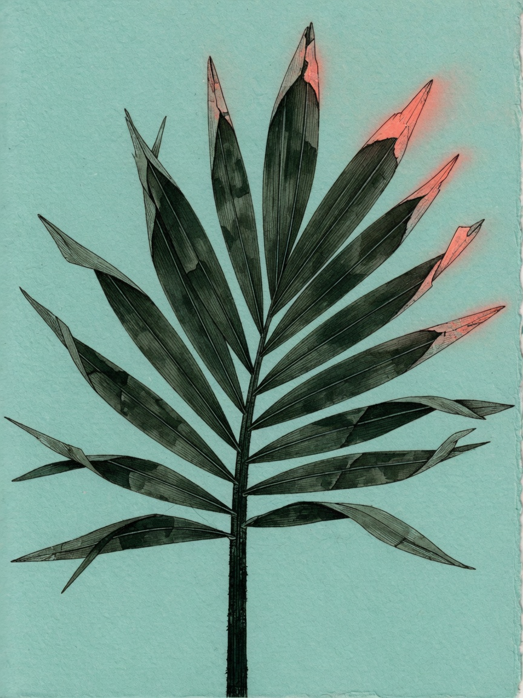

  

# olai

An outliner that lives in files you own. Git records it. A browser edits it. An agent can too.

**[olai.page](https://olai.page)** — what it is, how to run it, and why.

Start here: [docs/start.md](docs/start.md) · All the docs: [docs/index.md](docs/index.md)

## Status

olai is being developed quickly, and releases will break compatibility. Keep your notes in git.
