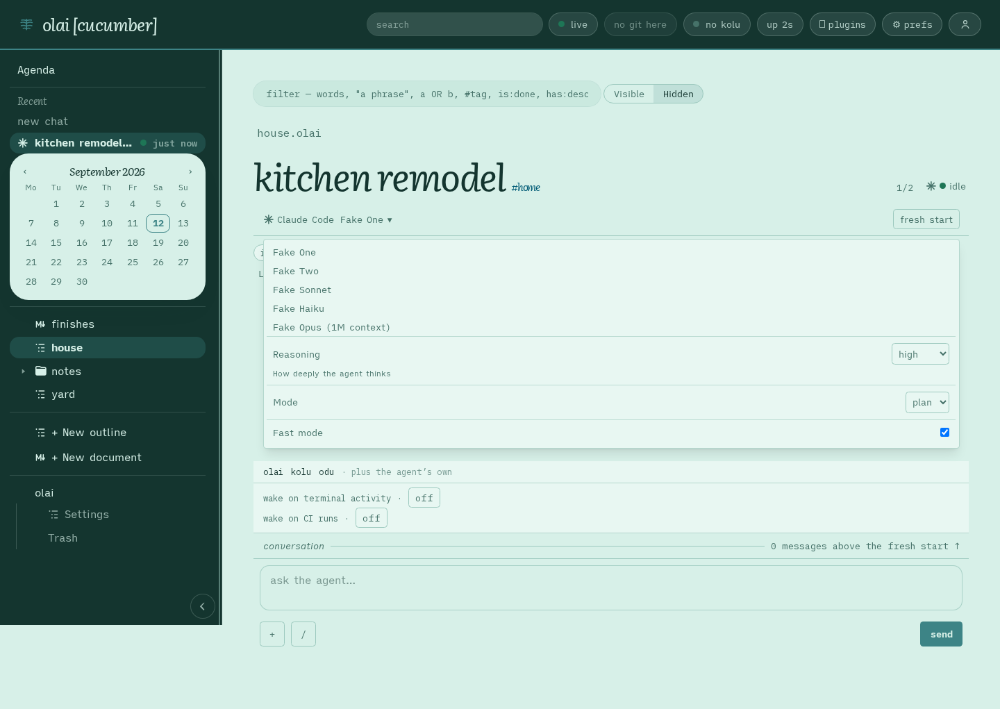
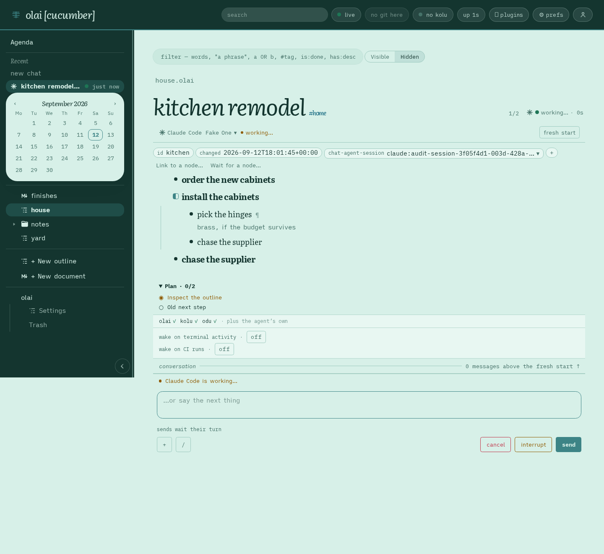
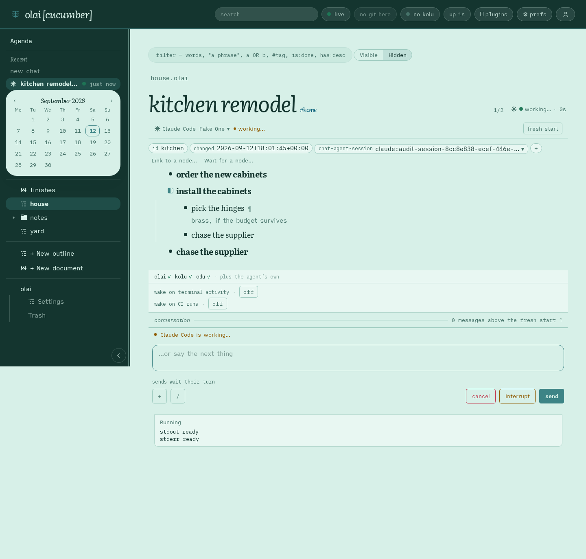

# Talking to an agent

olai runs a coding agent beside your notes. Pick an agent, sign in once, then type: the box never locks while the agent works.

## Pick an agent

A conversation belongs to one agent for its life.[^plugin] What each one needs:[^path]

| Agent | Needs |
| --- | --- |
| [Claude Code](plugins/claude.md) | nothing: olai ships its adapter |
| [Codex](plugins/codex.md) | nothing: olai ships its adapter |
| [OpenCode](plugins/opencode.md) | `opencode` on the search path |
| [Pi](plugins/pi.md) | `pi` on the search path |
| [Oh My Pi](plugins/omp.md) | `omp` on the search path |

With none of them installed, the panel says **No agent yet.** and lists what to install.[^none]

What differs between the agents

Anything an agent does not offer is not drawn. The differences you meet while typing:

| Agent | A message sent while it works | Interrupting | Agents it sends out |
| --- | --- | --- | --- |
| Claude Code | waits at the agent, marked *queued*, until it is picked up | **Interrupt** | drawn in lanes, behind their own door |
| Codex | steers the turn in flight | **Interrupt** | drawn in lanes, behind their own door |
| OpenCode | steers the turn in flight; a plain second message is refused with *Session already has an active ACP prompt* | **Interrupt** | drawn in lanes, behind their own door |
| Pi | waits at the agent, which announces its position in the queue | no control is drawn | drawn flat, every call in one column |
| Oh My Pi | replaces the turn: the running turn ends *cancelled* and your new message is answered | no control is drawn | drawn flat, every call in one column |

Each agent's own page carries the rest of what it supports. What a conversation does with a subagent's work is on [giving an agent work](giving-an-agent-work.md).

## Sign in

An agent with no credential can neither open a conversation nor run a turn, so olai shows the agent's ways in. Type `/login` to ask first.[^methods]

- A command olai runs for you.[^command]
- A page the agent opens.[^card]
- A command you type on the server.[^wizard]

One sign-in runs per agent at a time.[^one]

## Read the agent line

Under the conversation's title, one line says who you are talking to and what it is doing:[^line]

- the account it is signed in as[^account]
- the model, which you can change[^model]
- how full the context is, such as `22k/1M`[^context]
- **Working…**, **Waiting on you** or **Ready**

## Talk while it works

Press **Send** at any time.[^send] Press **Cancel** to stop the turn,[^cancel] or **Interrupt** (`Alt` + `Enter`) to break into it.[^interrupt] Plans and command output show as they arrive.[^plan] Under your message, a mark says what happened to it:[^status]

| Mark | Means |
| --- | --- |
| *queued* | waiting its turn; nothing to do |
| *not sent* | nothing took it; **Send again** |
| *no answer — it may not have arrived* | look at what the agent did next |

## Long conversations and restarts

A conversation holds the newest sixty rows.[^scroll] A restart reopens up to eight conversations that were live.[^restart]

[^plugin]: Each agent is a plugin. Switching that plugin off in the **Plugins** panel takes its choices away without touching the other agents ([choosing what runs](settings.md)). Starting a conversation on a row, and the **New chat** row in the palette, are on [node agents](node-agents.md).

[^path]: Claude Code's adapter can be swapped with `KOLU_ACP_AGENT`, Codex's with `OLAI_ACP_CODEX` and Pi's with `OLAI_ACP_PI`. `OLAI_AGENT_PATH` is where olai looks for the executables, and it replaces `PATH` rather than adding to it. Set it when olai's own `PATH` is not your shell's, which is what running olai as a service costs you ([keeping it running](deploying.md)). An empty adapter variable makes that agent unavailable, with an explanation, and leaves the other agents alone.

[^none]: Under **No agent yet.**, **Install one of these to start an agent:** lists every enabled agent this machine has not got, each with its reason and a link where one helps. The last line says your notes work without one. Each agent is probed once per activation, so after installing a command, switch its plugin off and on to ask again.

[^methods]: When an agent refuses for want of a credential, olai reads that refusal as its own case. A node bound to an agent that is not enabled here shows that agent's reason alone, because another agent may still be available. The **Plugins** panel files an enabled but missing agent under **Needs you**, with the same sentence.

[^command]: A sign-in command, which Claude Code offers, starts in the served directory. Its output streams into the row with the addresses clickable, and one line takes the code you type. Exit 0 is success. Anything else leaves the output on screen with a way to try again.

[^card]: A sign-in page is drawn as a card with the agent's own message, the destination host and a link. The agent says when the page is done with, and the request it was blocked on is answered.

[^wizard]: An agent whose sign-in is an interactive wizard, as OpenCode's is, gets a label and the exact command to type into a terminal on the server. No button is drawn for it. A box for an API key is not offered, so an agent whose only method is one is offered without it.

[^one]: A second press on the same method joins the attempt already running, and a press on a different one is refused, so two tabs watch one process and either can finish it. Cancelling stops it. Signing in retries what you asked for, and a turn refused for want of a signature stays marked *not sent*, with the words back in the box.

    Starting works before a conversation exists: a first start records only the chosen agent, and the conversation is written down once the agent opens one.

[^line]: The agent line carries the agent's mark and name, and its state: **Starting…**, **Working…**, **Waiting on you**, **Ready**, **Not running** or **Not set up**. Its verbs sit at the right: **Open in panel ›**, **Show in outline ›**, **Fresh start** and **Close**.

[^account]: The account reads as `Claude Max · you@example.com` for a subscription, `Anthropic API key · apiKeyHelper` for a key or a gateway, and `Not signed in` when the agent looked and found nobody. The organization, plan and detail are in the chip's tip, and pressing the chip asks for the sign-in chooser. An agent that does not report its account draws no chip, which is not the same as being logged out. Pi, Oh My Pi and OpenCode report none.

[^model]: Press the model name for **Change model**, type in its filter box to narrow the list, walk it with the arrow keys, and press `Enter` to take the row under the cursor. The box matches the agent's own identifier as well as its display name. A model your account cannot use says so, and any other row can still be taken. More on settings and `/model` is in the closed block at the foot of this page.

[^context]: `22k/1M` is how many tokens the conversation holds and how many fit. It is the agent's own number, sent several times a turn, so it moves while a turn runs. It is a fraction rather than a percentage because the window is not a constant: a conversation moves between windows when its model does.

    An agent that reports nothing leaves it silent, unlike a conversation that has spent nothing and says `0/200k`. You meet that before a fresh conversation's first turn, and on opening a stored one, which replays its messages without a usage report. The next turn fills it in.

[^send]: The box never locks, and **Send** says the same thing the whole time. While a turn runs, **Cancel** sits beside it, and on an agent that takes an interruption, **Interrupt** sits between them. Sending belongs to the conversation on screen when you press. A tab that has moved to another node cannot send, interrupt, cancel or retry here, and refused text with its attachments and chips returns to the conversation it came from.

[^cancel]: Pressing **Cancel** stops the turn and nothing else. Messages waiting behind it are at the agent, so they survive and run next.

[^interrupt]: An interruption goes into the turn in flight, so whatever the agent was in the middle of is torn down to make room. Once a conversation has queued a message, it stops offering the control for the rest of its life, and `Alt` + `Enter` becomes an ordinary send. A new conversation offers it again.

[^plan]: An agent that sends a plan draws **Execution plan** under the agent line, with pending, active and completed steps. Each update replaces the whole plan, an empty one removes it, and starting another conversation clears it. A tool call backed by a terminal shows its output as it arrives, then the exit code or signal, and stays readable after the agent releases the terminal. Pictures of both are in the closed block at the foot of this page.

[^status]: A line under the transcript says what is happening (*working…*, *starting…*, or that the turn has stopped on a question) and goes the instant the panel is idle. *Queued* means the agent is holding it until the turns in front of it end; the mark comes off by itself.

    *Not sent* means the turn or interruption was refused, the agent was not there, or you cancelled while it was on its way. **Send again** sends it for the first time, as an ordinary message. After *no answer* no button is offered, since a second send could be a second copy.

[^scroll]: A conversation opens at its newest line, and **Earlier messages** sits above the rows only where there are more. Pressing it fetches the page immediately before what is on screen, so scrolling back walks the conversation a page at a time, and the door goes once the start is reached.

    New text follows while you are at the bottom, and scrolling up keeps your place. A reconnect never takes a row away, and a short drop in the connection is invisible.

[^restart]: A restart reopens them, most recently touched first, before any browser asks. A reopened chat is closed 48 hours after it was last used, however many restarts that spans, and one already past that at boot is dropped. A switched-off agent's entry waits, so switching it back on brings the conversation back.

The agent's settings, <code>/model</code>, and models after a restart

Beside models, an agent may offer reasoning effort, an operating mode or a switch such as fast mode, under the names and values it chooses. All of them are available while the conversation is idle, and changing the model can change what the others offer. A refusal leaves the confirmed value in place with the agent's own reason.

Claude Code also takes `/model` in the box. The agent line then names the model the agent is running, which changes one turn late: the agent announces it as a turn starts, so the turn that ran the command still names the model it began on. A model the picker does not offer is shown as the identifier it arrived as, never rounded to the nearest row.

The agent re-reads its identity at every handshake, every conversation opened and the start of every turn, so a `/login` run elsewhere shows up on your next message.

A model you chose comes back after a restart, and the agent line names it before you type. A switch made in a terminal while olai was not running loses, because olai reapplies what it recorded. If the agent will not take the setting, the conversation opens anyway on the model the agent chose, with the reason in a row of its own.

What a plan and a command's output look like, and when a turn fails

Output keeps the newest complete characters with a truncation notice: 64 KiB by default, and up to 1 MiB where the agent asks for more. Commands olai owns run in the served directory unless the agent supplies an absolute one, and cancelling stops them with their process groups.

A turn that ends having produced nothing gets a notice naming the agent and asking you to check that it is signed in and that its provider key is in the environment olai itself runs in.

A conversation the agent refuses to open says **The agent couldn't open a chat.** with the agent's reason, a **Try again**, and, where it is the node's current chat, **Start fresh chat**. Two other refusals have faces of their own: a chat this machine has no record of, and every seat being taken ([node agents](node-agents.md)).

What comes back after a restart, and unsent words

A restart reopens the conversations that were live when the process stopped. At most eight are kept. The entry is dropped for a node that was trashed or lost its binding, for an agent that refuses the resume or asks to be signed in, and for an agent that has been uninstalled. A turn that was in flight is not recovered, so the reopened conversation is idle and its box is usable.

Unsent words, attachments and nodes chosen with `@` belong to their conversation in this tab. Folding the conversation or visiting its history keeps them, sending clears them, and reloading the tab discards them.

